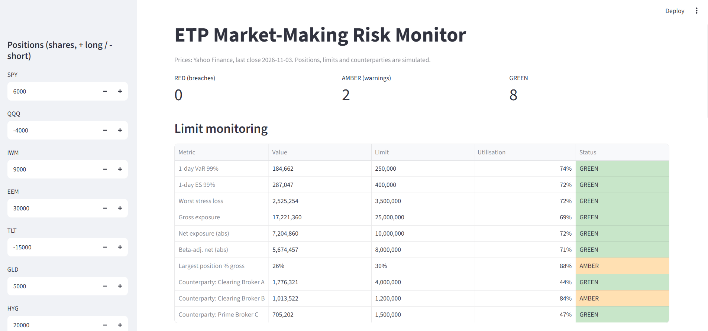
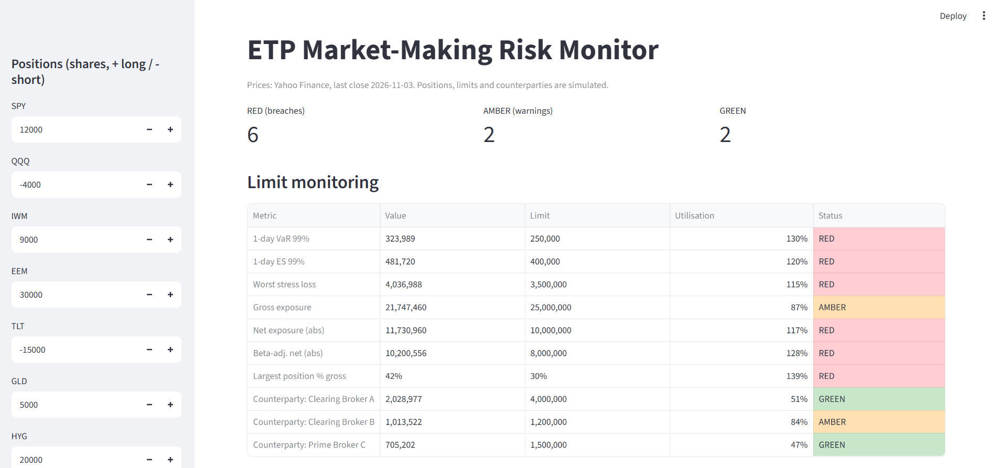

# ETP Market-Making Risk Monitor

A small risk-monitoring system for a **simulated market-making book in Exchange Traded Products (ETPs)**. It measures market risk and counterparty credit risk, tests the models behind them, checks everything against a limit framework, and shows the result in an interactive dashboard with a what-if tool.

The project was built to learn and demonstrate the day-to-day work of a market and counterparty risk function: monitor positions, measure and stress the risk, escalate limit breaches, and report to management.



> **Data note.** Prices are real (Yahoo Finance via `yfinance`). Positions, counterparties, margins, default probabilities and limits are **simulated** for demonstration. See [Assumptions and limitations](#assumptions-and-limitations).

---

## What it does

| Module | File | What it computes |
|---|---|---|
| Data | `src/data.py` | Downloads adjusted close prices for 8 ETFs (SPY, QQQ, IWM, EEM, TLT, GLD, HYG, VGK) from 2015, caches them, computes simple and log returns |
| Position book | `src/book.py` | Market value per position, long / short / net / gross exposure, beta to SPY, beta-adjusted exposure, hypothetical daily P&L |
| VaR and ES | `src/var.py` | Historical and parametric Value at Risk and Expected Shortfall (95% and 99%), 10-day scaling |
| Backtesting | `src/backtest.py` | Rolling out-of-sample VaR backtest, Kupiec test, Basel traffic light, exceptions per year |
| Stress testing | `src/stress.py` | 5 historical and 4 hypothetical scenarios, liquidity stress (spread widening) |
| Counterparty risk | `src/counterparty.py` | Monte Carlo (bootstrap) Potential Future Exposure, expected loss (PD x LGD x EAD), limit utilisation, concentration (HHI) |
| Limits | `src/limits.py` | Limit monitoring with GREEN / AMBER / RED zones and escalation messages |
| Dashboard | `app/dashboard.py` | Streamlit app with editable positions (what-if analysis) |
| Policy | `docs/risk_limit_framework.md` | Limits, roles, escalation, model validation and review cycle |

---

## Key results

Baseline simulated book: 12.2M $ long, 5.0M $ short, **net 7.2M $, gross 17.2M $**, beta-adjusted net 5.7M $. Prices up to 3 November 2026.

### Market risk (1 day)

| Measure | Historical | Parametric (normal) |
|---|---|---|
| VaR 95% | 106,172 $ | 115,632 $ |
| VaR 99% | 184,662 $ | 164,708 $ |
| ES 99% | 287,047 $ | 189,110 $ |

The normal assumption **understates** the 99% tail: its Expected Shortfall is about a third lower than the historical one. At 95% the opposite happens (the normal model is more conservative), which is the signature of fat-tailed returns.

### Backtest (rolling 500-day window, 99% VaR)

| Method | Exceptions | Expected | Kupiec p-value | Result |
|---|---|---|---|---|
| Historical | 38 | 24.8 | 0.013 | Rejected |
| Parametric | 53 | 24.8 | 0.000 | Rejected |

An in-sample check looks perfect (30 exceptions out of 30 expected) because the VaR is estimated on the same data. The out-of-sample test reveals the real behaviour: exceptions **cluster in crises** (13 in 2020 for the historical model), because a 500-day window reacts slowly when volatility jumps. For this reason VaR is never used alone in the limit framework: it is complemented by Expected Shortfall and stress tests.

### Stress tests (P&L of today's book)

| Scenario | P&L |
|---|---|
| Covid crash (Feb-Mar 2020) | -2.53M $ |
| Q4 2018 sell-off | -0.89M $ |
| Rate shock (H1 2022) | -0.81M $ |
| Tariff shock (Apr 2025) | -0.70M $ |
| Equity -10%, flight to quality | -0.66M $ |
| Credit event (spreads +300bp) | -0.51M $ |
| ETF flash crash (Aug 2015) | -0.50M $ |
| Gold crash -10% | -0.23M $ |
| Rates +100bp | -0.10M $ |

The same short position in TLT **gains** in a rate shock and **loses** in a flight to quality (Covid). Stress tests expose scenario dependence that a single VaR number hides.

### Counterparty exposure

| Counterparty | Margin | PFE 95% (10d) | Exposure / limit | Status |
|---|---|---|---|---|
| Clearing Broker A | 1.50M $ | 276k $ | 44% | GREEN |
| Clearing Broker B | 0.90M $ | 114k $ | 84% | AMBER |
| Prime Broker C | 0.60M $ | 105k $ | 47% | GREEN |

Most of the exposure is the **margin** posted with the broker, not market-driven gains. Concentration is low (HHI 0.38, perfectly spread = 0.33).

### Limit monitoring and what-if

At baseline the book shows 8 GREEN and 2 AMBER (largest position at 88% of its limit, Broker B at 84%).

Adding about 4.5M $ of SPY in the dashboard produces **6 RED, 2 AMBER, 2 GREEN**. The first limit to break is the **concentration limit**, after only about 1,200 extra shares, long before VaR or exposure limits are touched. This shows why a framework needs several complementary measures.



---

## Methodology in brief

- **Returns.** Simple returns for portfolio aggregation (a portfolio return is a weighted sum of asset returns). Prices are adjusted for dividends and splits.
- **Hypothetical P&L.** Today's positions applied to every historical day of returns, which gives the series used for VaR and ES.
- **VaR / ES.** Historical simulation (empirical percentile and tail average) and parametric (normal). The 10-day figure uses square-root-of-time scaling, which assumes independent days.
- **Backtesting.** VaR for day *t* uses only the 500 days before *t* (no look-ahead). Kupiec proportion-of-failures test and the Basel traffic light.
- **Stress tests.** Historical scenarios apply cumulative returns of a past period. Hypothetical scenarios shock risk factors and map them to ETFs: beta for equities, duration for TLT (-16.5% per +100bp), spread duration for HYG, a direct shock for gold.
- **Counterparty risk.** 20,000 bootstrap paths of 10 historical days (the same day for all ETFs, preserving correlations and fat tails). Exposure = margin + 95% PFE of the positive P&L on the products cleared by each broker. Expected loss = PD x LGD x EAD.
- **Limits.** Utilisation = value / limit. GREEN below 80%, AMBER from 80% to 100%, RED at or above 100%. Details in [`docs/risk_limit_framework.md`](docs/risk_limit_framework.md).

---

## Project structure

```
etp-market-making-risk-monitor/
├── README.md
├── requirements.txt
├── app/
│   └── dashboard.py
├── data/                     # price cache (git-ignored)
├── docs/
│   ├── risk_limit_framework.md
│   ├── dashboard.png
│   └── dashboard_whatif.png
└── src/
    ├── __init__.py
    ├── data.py
    ├── book.py
    ├── var.py
    ├── backtest.py
    ├── stress.py
    ├── counterparty.py
    └── limits.py
```

---

## How to run

Requires Python 3.10 or newer. Run every command from the repository root.

```bash
pip install -r requirements.txt

# Individual modules (each prints its results)
python -m src.data
python -m src.book
python -m src.var
python -m src.backtest
python -m src.stress
python -m src.counterparty
python -m src.limits

# Dashboard
streamlit run app/dashboard.py
```

The first run downloads prices and stores them in `data/prices.csv`. To refresh them, delete that file or call `download_prices(force=True)`. Results depend on the download date, so figures may differ slightly from the ones in this README.

---

## Assumptions and limitations

**Real:** daily adjusted prices from Yahoo Finance (an unofficial source: suitable for a portfolio project, not for production).

**Simulated:** positions, counterparties, margins, PD (0.05% to 0.30%), LGD (60%), limits, roles and escalation chain.

**Modelling limits:**

- Hypothetical P&L ignores intraday trading and changes in positions.
- Square-root-of-time scaling and the bootstrap assume independent days, which understates risk in crisis periods (volatility clustering).
- Both VaR models were rejected by the backtest. Possible improvements: EWMA weighting, filtered historical simulation.
- Stress shocks (durations, spread sensitivities, factor moves) are assumptions, not fitted values.
- The liquidity stress assumes fixed half-spreads and no market impact, so it is a lower bound.
- The counterparty model has no netting agreements, no collateral dynamics and no wrong-way risk.
- The ETP-specific measures of a real desk (premium or discount to NAV, creation and redemption flows) are not modelled.

---

## Possible extensions

- EWMA or filtered historical simulation, and a Christoffersen test for the independence of exceptions.
- Premium / discount to NAV and liquidity metrics (ADV, bid-ask) per ETP.
- Intraday refresh and a breach log stored in a database.
- Automatic daily PDF risk report.

---

## Skills demonstrated

Python (pandas, NumPy, SciPy, Streamlit), market risk (VaR, ES, beta, exposures), model validation (Kupiec, Basel traffic light), stress and scenario analysis, counterparty credit risk (PFE, expected loss, concentration), limit framework design and escalation, clear documentation of assumptions.